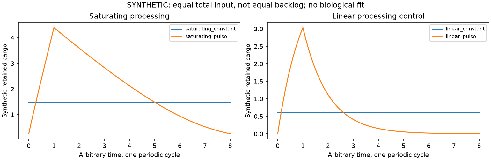

# 平均未超载，为什么仍会积压？
## Beyond Mean Capacity: Rejuvenation Load, Pulses, and Recipient State

**LONGEVITY小型研究增补｜2026-11-25｜独立外审未完成，不做正式专著合成**

本轮先完成工作区精简，再继续新探索。前轮研究与ZIP保持原样，本增补不重打包3份源表或网页缓存。

## 结论先行

上一轮的固定输入模型指出：源端输出J超过接收端最大处理能力V时，没有有限接收端稳态。但**“平均J<V”不能保证低积压**；它也不是一般意义的生物安全条件。

本轮进一步给出一个条件反例：同一周期送入相同总量、接收端最终处理相同总量、没有持续累积或接收者死亡，集中输入仍可能造成更高平均滞留。

**真正值得实测的问题不是“有没有更多巨噬细胞”，而是：在什么处理阶段、什么既往负荷和输入节律下，接收者还剩多少可用功能？**

这不是新的排队数学，也不是已证实的抗衰给药策略。新的研究价值只能来自具体细胞系统中的可识别验证。

---

## 一、继续追溯先例：把“新领土”再收窄一层

### 1. 心肌细胞外包维护，2020年已有原始证据

Nicolás-Ávila等的Cell研究报告：心肌细胞将异常线粒体等cargo以exopher样结构释放，心脏巨噬细胞摄取；巨噬细胞去除或Mertk缺失与异常cargo清除受损、炎症小体激活、自噬受损和心室功能异常相关。实际读取的是原研究PubMed摘要，而不是把评论当原始证据。

原始文献入口：https://pubmed.ncbi.nlm.nih.gov/32937105/

**因此“长寿实质细胞依赖邻居维护”绝不能归为本轮首创。** 也不能将受体/整群细胞去除的多效性实验，自动解释成只降低终端降解V。

### 2. 2023年研究已经区分不同输出通路

Nature Communications原研究报告，在溶酶体功能受限时，含线粒体的大EV分泌增加，经多泡体/内体途径，论文所述该路径不依赖自噬；分泌物被巨噬细胞摄取，作者在其条件下未观察到炎症激活。

原始文献：https://www.nature.com/articles/s41467-023-40680-5

实际读取fetch chunk0的摘要和引言部分；搜索另提取到讨论片段，未通读全部20块或复算其源表。

**两个重要修正：**

- 2020年的自噬驱动exopher与2023年的自噬非依赖EV不能简单揉成一种机制；差异不自动构成论文矛盾。
- 输出增加、被邻居摄取，不一定产生炎症。不能先把“向外输出”定义为坏事，再用任何输出支持风险转移假说。

### 3. 棕脂存在另一个直接先例，但终点仍不是寿命

2022年Cell Metabolism研究报告，棕脂细胞经EV输出受损线粒体成分，驻留巨噬细胞参与移除；其去除与EV积累和产热功能受损有关。[4](https://www.cell.com/cell-metabolism/fulltext/S1550-4131(22)00088-2)

读取限制：web_search返回摘要/结果/讨论相关片段；fetch出版方链接只返回网页壳，不称阅读全文。该研究支持在特定组织中研究处理分工，不证明人体延寿，更不证明接收者在替供者“衰老”。

### 4. 一次摄取后的状态改变，既可能妨碍也可能促进下一次处理

2017年Cell原研究显示，凋亡细胞摄取触发Drp1介导的线粒体分裂，支持巨噬细胞连续胞葬；扰动相关机制影响后续凋亡细胞摄取，部分缺陷可通过MCU相关操作纠正。实际读取原研究PubMed摘要和Figure1部分图注。

原始文献：https://pubmed.ncbi.nlm.nih.gov/28942921/

**这迫使我们放弃“接收越多→一定越疲惫”的单向假定。** 前次负荷可以触发适应性重塑；“线粒体更碎就是更老/更差”也不是跨细胞类型通用规则。该研究不等于所有增加分裂的操作都有益。

### 5. 2026年综述已经提出输出—处理的广义双刃剑框架

*Extracellular Mitochondrial Components as Emerging Biomarkers and Therapeutic Targets in Human Diseases*，IJBS 2026，doi:10.7150/ijbs.140360。

https://www.ijbs.com/v22p8390.htm

实际读取网页chunk0的元数据、摘要与引言开头；另有搜索提取。该综述已讨论内部降解与胞外输出的平衡、癌症和神经退行性病变。因此本轮不是“发现细胞是开放系统”，也不声称输出型克隆竞争的整个概念无人讨论。

---

## 二、对上一轮容量边界的必要限定

上一轮的方程是：

```
dR/dt = J − V R/(K+R)
```

当J恒定时，J<V是有限稳态条件，R*=KJ/(V−J)。

这只处理了**固定输入、固定容量、一种cargo、无反馈**的情形。不能把它直接翻译成：“平均输出小于处理容量，所以没有问题。”

对时变输入，需要区分：

1. **长期稳定性**：是否无限积累；
2. **峰值滞留**：短时最高积压；
3. **平均滞留/暴露时间**：整个周期积压面积；
4. **功能损伤**：必须另测，不能由前三项自动推断。

下面只证明前三者可以分离，不宣称已证明第四项。

## 三、一个无需生物数据拟合的条件结果

令J(t)为周期输入，系统已达到周期稳态：R(T)=R(0)。处理率f(R)=V R/(K+R)。

由质量守恒：

```
平均 f(R) = 平均 J = Jbar
```

对R≥0且V,K>0，f单调递增且严格凹：

```
f''(R) = −2 V K/(K+R)^3 < 0
```

由Jensen不等式：

```
f(平均R) ≥ 平均f(R) = Jbar
平均R ≥ K Jbar/(V−Jbar)       （Jbar<V）
```

只要周期内R真正波动，严格凹性使不等号为严格。右边正是相同均值恒定输入的稳态积压。

**条件结论：在这个固定、凹性饱和处理模型内，脉冲输入即使总量不变，也能提高平均滞留。**

这不是说所有非线性都如此，更不是说治疗应持续给药：真实干预可以改变源端生成、作用选择性、处理能力、免疫招募和损伤修复。若输入脉冲诱导V上升、如果处理函数并非全程凹、或若两种处理路径在不同负荷区间启用，结论都须重算。

**已有应用数学结果，不申报新定理。** 我们只是用它纠正前轮假说最容易被误读的地方。

## 四、实际计算：相同输入与处理总量，不同积压

脚本[pulse_counterexample.py](pulse_counterexample.py)实际运行成功。所有量为人为无量纲参数：V=K=1，平均输入0.6，周期8。集中输入只占周期的1/8，输入率4.8，其余时间为0；两方案每周期均输入4.8。

先从零积压迭代到周期闭合，再比较同一完整周期，不拿起始过渡期冒充稳态。积压面积与累计处理量作为额外ODE状态直接积分。

| 处理规律 | 输入方式 | 每周期处理量 | 平均滞留 | 峰值滞留 |
|---|---|---:|---:|---:|
| 饱和处理 | 恒定 | 4.800 | 1.500 | 1.500 |
| 饱和处理 | 集中 | 4.800 | **2.020** | **4.400** |
| 线性负对照 | 恒定 | 4.800 | 0.600 | 0.600 |
| 线性负对照 | 集中 | 4.800 | **0.600** | **3.035** |

在饱和模型内，平均滞留上升约**34.7%**，但总处理量没有下降。不能由“总清除了多少”判断中途暴露相同。

线性负对照很重要：峰值仍上升，但平均滞留不变。这说明不能只看高峰，便声称已识别饱和导致的平均积压代价。



21项实现检查通过，包括周期闭合、质量守恒、非负性、同周期处理总量、解析恒定解、线性负对照和停输入后的洗脱。原始模拟轨迹见[SYNTHETIC_PULSE_TRACES.csv](SYNTHETIC_PULSE_TRACES.csv)，数值和参数见[RESULTS.json](RESULTS.json)。

**没有不可逆性。** 在这个模型中停输入后积压可以消退；它不产生组织损伤、克隆进化或真正的持久记忆。因此不能把图上的积压叫“不可逆衰老”，也不能声称这个模型已经解释了前轮生态顺序效应。

---

## 五、真正的下一块矿脉：处理余量是否取决于任务历史？

固定V模型只是基线。结合连续胞葬原始研究，更有研究价值的待验证分叉是：

### H-A：容量适应

前次负荷触发功能重塑，使后续处理更快；短期有积压，但恢复/持续处理能力增强。

### H-B：容量占用

前次cargo尚未处理，后续cargo排队；充分洗脱后恢复，无持久细胞损伤。

### H-C：接收者功能损耗

负荷后接收者功能持续受损，即使残余cargo已减少，后续处理仍受影响。

### H-D：识别或接触受限，而非终端处理受限

差异主要由受体识别、细胞迁移、接触机会或空间输运造成；提高终端处理也不解决。

这些机制能产生相似的“第二次摄取减少”图像，却意味着不同的干预靶点。不能把它们都命名为V下降。

## 六、一个比大规模寿命实验更有判别力的小实验

**双轮挑战×恢复间隔×处理阶段分离**；先只研究同一种定义清楚的cargo，不跨凋亡细胞、EV和脂蛋白混合计量。

1. 对接收者随机分配相同总cargo的集中或分散预负荷；验证实际送达、摄取、终端产品，不只匹配培养液加样量。
2. 在多个恢复间隔后，给予第二轮标准化示踪挑战；两轮用可区分的标记，并验证标记不改变识别。
3. 分开测接触/结合、内化、残留、终端处理产品与接收者存活/功能。
4. 既按相同总经过时间比较，也另设有解释目标的恢复状态匹配比较。后者改变的是估计问题，不能简单把随机化后的残余负荷当协变量，宣称剥离出全部直接效应。
5. 若第一轮结束后仅残余多、充分洗脱后第二轮恢复，支持占用而非持久损耗；若第二轮增强，支持适应；若残余已消失但功能仍差，才值得追持久损耗/重塑机制。
6. 用供者层重复和阶段特异性正交扰动，避免把视野数当独立n。实际样本量待pilot方差与预设最小有意义效应决定。

下一阶段才增加不同cargo的交叉挑战。**不同cargo是否共享瓶颈必须实测**：共同进入一个巨噬细胞，不等于争夺同一个限制性步骤。若只对同类cargo有影响，可能是特异识别适应；若跨类影响且能由终端处理恢复，才增强共享瓶颈解释。

### 能推翻本轮具体模型的结果

- 在经过实测的凹性、固定处理函数范围内，匹配输入后稳定周期平均滞留不符合预测：优先检查模型与测量，而非宣布新物理。
- 脉冲同时提高处理能力，消除了甚至反转积压差异：固定V假设失效，但可能开启适应性容量研究。
- 真正控制送达量后差异消失：原现象可能来自输运而非处理。
- 仅有荧光差异，无产品/功能差异：不能声称健康代价。

## 七、对LONGEVITY的增量意义

前轮问“谁在为年轻买单”；这一轮增加的是：**什么时候付、以什么任务付，以及处理者能否因此变得更能干，而不只是被耗损。**

有价值的候选目标不是简单“输出更少”“分散一定更好”或“先把巨噬细胞变年轻”，而是识别一个系统在不同任务历史中的**功能处理余量曲线**，并检验它能否预测源端获益与接收端后果。

这离新疗法仍很远；但比增加一个静态年龄指标，更直接指向可被实验否证的机制。

---

## 范围、存储与复现

- 文献：本轮只存读取范围、URL和结论摘述，不重复缓存PDF/HTML；出版方Cell链接的壳响应未当全文。
- 计算：`OPENBLAS_NUM_THREADS=1 python pulse_counterexample.py`；复用前轮requirements中的numpy/pandas/scipy/matplotlib，无新增大型依赖。生成物标明SYNTHETIC。
- 检查是本助手实现自查，不是独立审稿。未做新实验、真实数据拟合、人体剂量建议、寿命预测或正式专著合成。
- 四个机制分叉是未来实验假说，未因模拟成功而获得实证支持。
- 不修改前轮研究包与manifest，不新增大ZIP或HTML。历史展开目录的精简恢复映射另见工作区根目录WORKSPACE_CLEANUP_RECEIPT.json。
