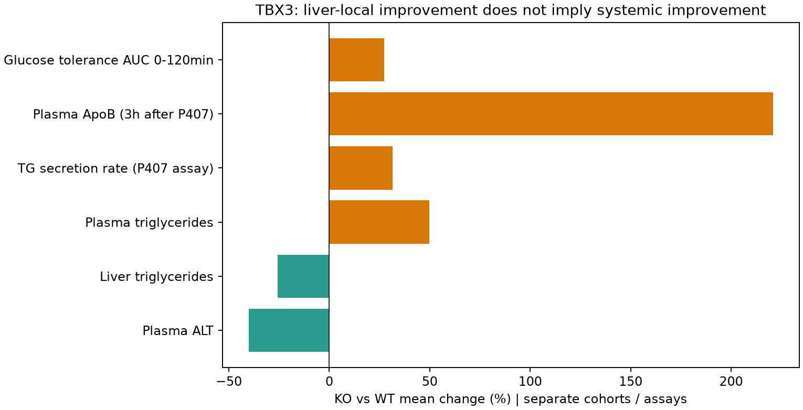
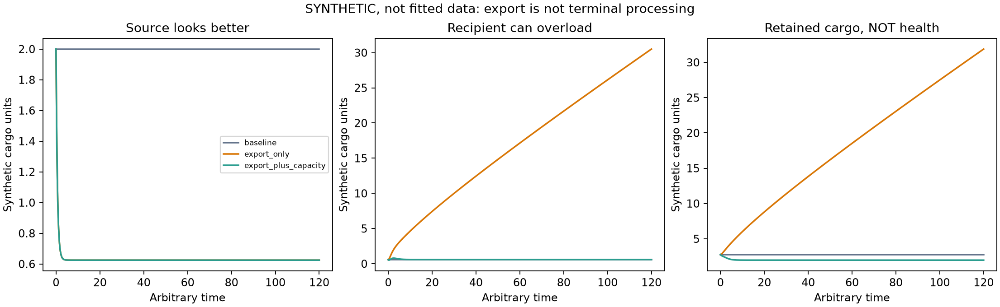
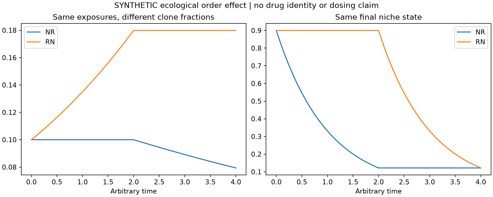

# 谁在为年轻买单？
## Who Pays for Rejuvenation?
### 新研究领土：接收端容量、体细胞进化与干预顺序

**LONGEVITY自主研究增补｜会话日期2026-11-25｜工作假说，不是完整V8或正式合成稿**

> **本轮主问题不再是“状态是否回到年轻”，而是：局部年轻化是否依赖别的细胞替它处理负担；这种分工能否承受克隆扩张，以及我们改变它的先后顺序？**

本轮已完成新文献定向搜索、原始来源溯源、三份新研究源表的选择性复算，以及两类最小机制反例。没有继续分析第四轮表达矩阵，也没有扩建仪表盘或治理引擎。下面把已知事实、自己复算、条件推导与大胆猜想分开。

## 0. 先给结论：值得投资的不是一个“年轻化总分”，而是一个交叉实验

**优先矿脉：输出型细胞的局部获益，是否受接收端终端处理能力约束？这种约束能否随克隆比例变化而被越过？**

它连接三个已有但不能相互替代的事实：

- 一些克隆通过改变代谢输出获得局部优势，器官获益却可能伴随全身代谢代价；
- 长寿细胞可以把部分线粒体维护工作交给其他细胞；
- 突变细胞不只是被生态位选择，也能塑造有利于自己的生态位。

**候选新意在具体交互的识别，不在宣称这些机制由我发现。** 我查到了直接讨论器官—个体利益冲突、清除失败、系统优先与有益突变的既有研究，因此撤掉这些大口号的新颖性主张。详见[近邻文献与新颖性边界](docs/近邻文献与新颖性边界.md)。

---

## 1. 第一条矿脉：有时“自己变好”，靠的是增加向外输出

### 1.1 真实公开数据：肝脏改善与系统代谢改善可以分离

TBX3原始研究用人类肝组织发现突变，并在鼠模型中研究机制：肝脏Tbx3缺失可减轻脂质积累，并增加VLDL输出；作者已明确讨论克隆、器官与个体利益不一致。[1](https://www.jci.org/articles/view/191855)

本轮从出版方真实Supporting Data Values工作簿重算：

| 指标 | 条件、源图与实际数值条目 | KO相对WT组均值变化 |
|---|---|---:|
| 血浆ALT | 西方饮食3个月，Fig2F，12/12 | **−40.18%** |
| 肝组织甘油三酯 | 西方饮食6个月，Fig2H，10/10 | **−25.58%** |
| 血浆甘油三酯 | 西方饮食6个月，Fig4D，10/10 | **+49.68%** |
| 葡萄糖耐量AUC，0–120分钟 | 西方饮食6个月，Fig4A，各10条完整曲线 | **+27.40%** |
| TG分泌率 | 西方饮食2周、P407测定，Fig5K，7/8 | **+31.58%** |
| 血浆ApoB，次要追加描述 | P407后3小时，Fig5L，7/7 | **3.209倍** |

这里是同一指标的组均值比，不是配对效应或本助手新增的生物学发现。ALT是损伤相关指标，AUC不是直接测得的寿命风险。不同图、时长和测定不能拼成“同一只鼠先改善后恶化”的轨迹；ApoB处于特定测定条件，不能冒称其3.209倍就是日常稳态血中粒子负荷。分泌率增加本身也不等于有害。

主文只重点使用预先固定的ALT/TG/GTT/分泌问题；ApoB是看表结构后追加的次要描述。绝对轴单位未独立核清，故不编造单位，仅报告无量纲比值；逐单元格数据与原生数值保存在results中。

**关键债务：稀有克隆不等于全肝KO。** 这些结果不能告诉我们人体一个1%或10%的TBX3突变克隆会产生多大全身效应，也没有直接测量动脉粥样硬化事件或寿命。本轮最有价值的空白，正是从“方向冲突已有证据”推进到“克隆负荷与接收端余量共同决定结果”。

### 1.2 不要把所有输出都叫排毒

脂质是营养和正常生理底物，不是统一的“垃圾”；输出可能是健康分工，也可能是风险转移。线粒体、细胞尸体、脂蛋白和炎症信号不能混成同一种守恒损伤。

更精确的问题是：对**一种定义清楚的cargo**，源端减少究竟来自生成减少、源内处理、输出、死亡还是增殖稀释？离开源端后，是被接收、暂存、整合、降解、失活，还是排出体外？

**源端指标下降 ≠ 身体终端处理完成。** 这是本轮实验设计的切入点，不是一个新的万能衰老理论。

---

## 2. 第二条矿脉：长寿可能是一种细胞间分工，而非单个细胞的独立品质

2026年Nature Cell Biology原始研究识别了Leydig细胞与不同睾丸巨噬细胞亚群的双向网络：LC向CD206hi巨噬细胞输出含缺陷线粒体的EV；另一方面从MHCIIhi亚群获得含功能线粒体的EV。Trem2或Vcam1相关扰动可破坏相应转运并损害睾酮生成；论文也报告年龄相关网络衰退。[2](https://www.nature.com/articles/s41556-026-01896-x)

**这项网络本身已有研究，不是本轮发现。** 更大胆但未验证的问题是：

> 当我们增强长寿实质细胞的输出或工作量时，维护它的“照护细胞”是否会先耗尽处理余量？源细胞看似更年轻，是否可能以接收者更高周转、溶酶体负荷或功能损耗为代价？

我把它暂称为**照护端代价 / caretaker cost**，只是研究问题标签。不能因为巨噬细胞承担处理，就断言它在“替别人老去”；需要直接追踪其功能、更新、死亡与补充。

### 一个会改变研究重心的反直觉点

最先修复的靶细胞，未必是最显眼的老化细胞，也可能是维持其他细胞功能的接收/处理者。但不能直接跳到“清除系统优先”处方：2026年Science已有恢复组织驻留巨噬细胞清除老化中性粒细胞、改善鼠多器官表型的研究，2026年的系统优先观点也已提出类似广义思路。[3](https://www.science.org/doi/10.1126/science.aea3075) [4](https://doi.org/10.18632/aging.206430)

**本轮保留的窄问题是：输出刺激×终端处理能力的交互，而非再次发明“清除很重要”。** 同样，促进衰老细胞死亡与促进胞葬相结合也已有USP7相关预印本；读取其v4摘要后，只把它作为联合思路的先例，不将旧版“kill and bury”标签升级为普遍机制证明。[5](https://www.biorxiv.org/content/10.1101/2023.11.15.567232v4) 2026年failed-resolution综述也明确以器官特异性的处理与重建容量组织问题，因此“容量受限的修复”本身亦不能冒称新颖。[10](https://www.mdpi.com/1422-0067/27/20/8987)

---

## 3. 一项可计算的条件：本地改善与接收端稳态可以相反

**本节全部模型参数均为人为无量纲演示，未拟合TBX3、EV或人类数据。** 模型不是支持假说的独立实验，只用于揭示需要测什么。

令源端cargo存量L、生成g、源内处理kL、输出eL。则源端稳态：

**L*=g/(k+e)**，输出通量 **J=ge/(k+e)**。

若接收端处理是饱和过程V·R/(K+R)，则：

- J<V：接收端可以有有限稳态，R*=KJ/(V−J)；
- J≥V：这个最小模型没有有限接收端稳态。

所以，e升高可以让源端L持续下降，同时把接收端推向积累。**甚至不用超过最大容量，整个网络的滞留cargo也可能增多。** 演示中，两种状态都在容量内，源端从2降到0.625，总滞留却从2.467升至5.125。

这不是说“损伤翻倍”：模型中的cargo量不等于健康损害，不同细胞位置与化学形态的风险不同。所有轨迹均检查了生成—转运—终端处理账目，推导见[模型与可识别性](docs/模型推导与可识别性.md)。

### 3.1 真正有研究潜力的交叉点：克隆扩张可以改变接收端负荷

若输出型克隆比例为x，WT与该克隆的单位输出分别jW和jM，则固定细胞数、固定容量下：

**J(x)=(1−x)jW+x·jM。**

在jW<V<jM时，容量边界为：

**xcrit=(V−jW)/(jM−jW)。**

这不是临床安全阈值。它提出一个可证伪预测：**同样的克隆负荷，在接收端处理余量不同的组织里，可能有不同后果；同样的源端改善，也可能有不同系统结局。**

若实测结果由源端生成变化或受体炎症信号完全解释，而不随终端处理能力变化，这个假说应被削弱，而不是重新命名任何坏结果为“容量耗尽”。

---

## 4. 第三条矿脉：年轻化改变的可能是相对适应性，而不仅是绝对功能

2026年克隆造血研究显示，Dnmt3a突变造血细胞可经可溶性因子诱导MSC衰老，衰老基质又支持突变细胞的优势；论文包含遗传与药理干预。这是已发表机制，不是本轮提出。[6](https://www.nature.com/articles/s41556-026-02025-4)

本轮复算其中ABT-263源表，仅作描述：

| 受体鼠终点 | 对照造血组：vehicle→ABT | 突变造血组：vehicle→ABT | 两组变化之差 |
|---|---:|---:|---:|
| 衰老MSC频率 | 1.340%→1.164% | 3.618%→1.258% | −2.184个百分点 |
| 供者BM贡献 | 49.040%→52.456% | 74.775%→51.470% | −26.721个百分点 |
| 供者HSC贡献 | 28.510%→35.867% | 62.900%→45.240% | −25.017个百分点 |

每个终点四组实际n分别10/9/8/10，与图注吻合。没有把不同图的行序当成同鼠配对，没有计算新的交互p值。ABT不是MSC特异性干预，故这些数本身不能证明所有效应只经MSC发生。

另一项2026年原始研究发现，同一β-catenin改变在年轻健康与受损/老化肝脏中具有不同适应性。[7](https://www.nature.com/articles/s41467-026-76373-y) 本轮只从Figure1C复算了年轻健康肝脏的**每鼠均值**：6.5个月时突变标记细胞/报告对照的组均值比约0.0591。各时点是破坏性取材的不同队列，不是同鼠连续损失率；受损/老年背景的扩张仍依据原论文，未把数千克隆伪装为独立鼠重复。

### 应升级的研究问题

**一个干预可以同时改善WT和突变细胞的绝对功能，但谁改善得更多，才决定相对选择方向。**

因此候选“进化稳健的年轻化 / evolution-aware rejuvenation”不应只问年龄钟降多少，而应同时问：

- 正常细胞功能是否改善？
- 已存在的高风险克隆，绝对数量和相对优势如何变化？
- 有益竞争者或细胞空间屏障是否保留？
- 改善能否在处理端余量不同、基因型不同的背景中保持？

不能保证对所有未知突变“进化无漏洞”；最多对预定义基因型和生态条件面板测稳健性。也不能把健康/老化两种背景的对照，直接当成已证某种实际年轻化治疗能逆转已建立的克隆。

---

## 5. 第四条矿脉：相同终态生态位，可能留下不同的克隆未来

新的实验切口不是笼统“联合干预更好”，而是**顺序差异是否由生态选择造成**。

最小模型中，N改善生态位，R是泛化再生刺激；克隆相对增长率随生态位而变。令N→R与R→N具有同样总暴露、同样时长，模型可以得到：

- 最终生态位状态完全相同；
- 但最终克隆比例不同，因为扩增发生时的竞争环境不同。

**人为参数演示：** 初始突变比例10%，N→R后为7.94%，R→N后为17.99%。这不是药效预测；输入没有实际药名与剂量。

最重要的是反例检查：把“生态位影响相对竞争”的系数设为0，顺序差异消失；把系数反号，优选顺序反转。**所以它不支持普遍“先清除、后再生”，更不能直接推出先senolytic、后OSK的临床建议。**

真正需要的是等暴露顺序实验、足够洗脱和统一随访起点，并同时测生态位、绝对克隆数、克隆比例及器官功能。若差异只存在于药物残留期，或由第一阶段改变第二阶段有效剂量解释，就不能称生态进化记忆。

## 6. 一个必须保留的反方向：不是所有突变都应该被“清零”

NOTCH1研究已经表明，正常食管中的扩增与肿瘤中的适应性不是一回事；特定模型中Notch1缺失能限制肿瘤生长。[8](https://www.nature.com/articles/s41588-022-01280-z) 更广义的多层选择冲突也已有成熟讨论。[9](https://journals.plos.org/plosbiology/article?id=10.1371%2Fjournal.pbio.3003290)

因此，“减少所有体细胞突变/增加克隆纯净度”不是自动正确的目标。**值得测试而尚未由本轮证明的是：某种实际细胞替换或克隆清除，是否会同时移除原本限制高风险克隆的邻域竞争者？**

这也不支持保留所有突变或主动引入突变。功能、空间竞争、基因型组合与宿主代价必须分开测。多样性本身不是永远有益，单一高适应性克隆也不是必然恶性。

---

## 7. Known Unknowns：四个足以推进或推翻方向的问题

| 关键未知 | 最小有识别力的实验 | 什么结果会削弱假说 |
|---|---|---|
| 源端获益是否伴随接收端代价？ | 同一cargo的供者—接收者示踪；独立改变接收端降解能力，同时测两端功能 | 控制源端生成后，接收能力变化不改变输出相关代价；或改善主要来自生成下降而非输出 |
| 克隆比例与容量是否交互？ | 固定总细胞数，改变输出型克隆比例×接收者终端处理能力；预先测通量—底物曲线 | 未见预测交互，观察到的边界随其他因素而非终端处理移动 |
| 顺序能否留下停药后的选择差异？ | N→R/R→N、单独干预、无干预；匹配暴露/间隔；洗脱后统一挑战 | 匹配实际有效暴露后差异消失，或只是瞬时PK效应 |
| 清除/替换是否破坏抗癌竞争？ | 带空间信息的WT—保护性竞争者—高风险克隆模型，分别测屏障与侵袭 | 替换不增加危险克隆机会，或新的正常细胞更有效维持竞争屏障 |

**最优先的是第一项，并以第二项为扩展。** 先证明“谁接受、谁处理、谁受损”，再问克隆进化；不应直接上长寿试验或用年龄钟代替终端通量。

详细方案、停止条件和解释竞争见[最小判别实验](docs/最小判别实验_从矿脉到可证伪问题.md)。

## 8. Unknown Unknowns：不是列玄学，而是寻找模型会在哪失效

以下是待侦测失败模式，不是本轮已观察到的现象：

1. **cargo化学身份改变。** 输出物在运输中被改造，毒性和识别不同，原先的简单质量流模型失效。
2. **接收者不是被动垃圾桶。** 摄取可能改变免疫识别、抗原呈递或营养供给；有时提高处理能力反而支持恶性细胞或引发自身免疫。
3. **源—接收关系反转。** 已在LC网络中看到不同亚群承担相反方向的转运；一次干预可能同时影响供给与处理，单一“巨噬细胞更多/更少”指标会遮蔽结果。
4. **空间先于总量。** 局部处理饱和可能发生在全身平均血指标仍正常时；总容量足够也未必输运可达。
5. **净获益来自代价再分配，但依然值得。** 负担转移并不自动不可取；若接收者能安全处理，它可能正是有益分工。需要测收益和代价，不能把一切输出污名化。
6. **稀有克隆根本不构成可测系统负荷。** 全肝KO表型可能无法外推到生理稀有克隆；若如此，主假说必须限于高负荷、局部邻域或特定疾病背景。
7. **进化目标不等于功能目标。** 减少突变比例可能同时减少正常输出，或由WT过度扩张造成；必须同步测绝对数和器官功能。

这些未知决定下一轮如何改变实验，而不是再添一个概念分类器。

## 9. 旧债只处理了会改变方向的四项

- **细胞/器官/宿主不混为同一适应性单位。** 新源表已经给出冲突实例，但宿主寿命仍未知。
- **整体干预不冒充稀有克隆效应。** 这一缺口未还清，变成主实验的核心变量。
- **摄取不冒充终端清除。** 仍需通量与产品端验证，不能靠标记位置作结。
- **没有“无人做过”认证。** 已找到多条近邻文献并收窄主张；模型只是可复算反例，无独立外审，不做正式合成。

LIFE、mtDNA以及旧框架的其他证据债本轮没有重跑或宣布关闭。V6/V7和前四轮冻结文件保留原状。

## 10. 对LONGEVITY写作的意义

**建议暂作独立研究章/companion hypothesis note，而不是直接并入一套宏大衰老理论。**

- 中文工作题名：《谁在为年轻买单？器官获益、接收端容量与体细胞进化》
- English: *Who Pays for Rejuvenation? Organ Benefits, Recipient Capacity, and Somatic Evolution*
- 更窄的论文候选：*Clearance-Constrained Somatic Selection: A Testable Source–Recipient Interaction Hypothesis*

对V6：从“维护哪个器官”推进到“维护器官之间的处理分工”。

对V7：从“谁在变年轻”推进到“谁的局部获益改变了谁的未来选择”。

**最大的雄心不是把所有衰老统一进一个词，而是找到一种能让正常功能改善、处理负荷可承受、又不奖励危险克隆的干预组合与顺序。** 本轮还没有这种疗法；它提出了比年龄钟回落更难、也更值得做的实验目标。

---

## 复现与交付边界

- 原始公开数据：3份新研究xlsx源表；只分析固定或显式追加的小部分，不声称整套研究独立重复。
- 主要产物：[源表逐项对比](results/SOURCE_CONTRASTS.json)、[原始单元格长表](results/SOURCE_VALUES_LONG.csv)、[模型条件与检查](results/COUNTERMODELS.json)。
- 代码：source_reanalysis.py与mechanistic_countermodels.py；后者参数全部人为，无药物剂量或人体预测。
- 失败：[下载/首次计算失败与局限](docs/SOURCE_FAILURE_AND_LIMITS.md)；源表不一致没有修补。
- 不把缓存等同通读：Science与Aging使用fetch工具读取结构摘要/摘要等，requests缓存受限；未声称审阅其全部Methods/SI。完整来源层级见近邻表。
- 没有新实验、原始reads重比对、正式因果识别、寿命预测、独立外审、新颖性认证或远端提交。无新HTML或STATE_DASHBOARD。
