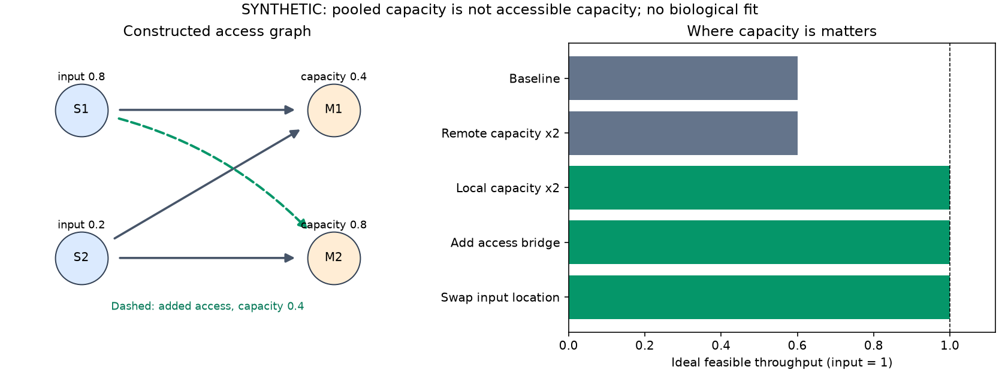

# 有余量，却用不上
## Inaccessible Reserve: A Spatial Blind Spot in Rejuvenation Research

**LONGEVITY小型研究增补｜2026-11-25｜研究工作稿，独立外审未完成**

> 组织里有多少“能干的细胞”，不等于局部负担能找到多少可用帮助。

## 1. 这一轮向前走在哪里

前两轮分别研究了：

- **谁接收负担**：源端改善不代表网络获益；
- **什么时候接收**：平均输入不超载，集中输入仍可提高积压。

本轮增加第三个维度：**处理余量在哪里，以及负担能否到达那里。**

新的具体问题不是再次宣称空间很重要，而是：

> **如果一种年轻化操作改善了分离细胞的功能，但未恢复原位接触、移动和负担分配，它是否会在离体测定中显得成功，却仍不能修复组织维护？**

本轮没有实际测试任何年轻化治疗。以下分开报告既有实证、源表复算、模型条件及待验证的测量盲点。

---

## 2. 已有原始研究，比宏大假说更具体

### 2.1 eLife 2022：趋化能动，不代表日常巡查有效

Paterson与Lämmermann的原始研究 *Macrophage network dynamics depend on haptokinesis for optimal local surveillance*，doi:10.7554/eLife.75354，在三维培养与鼠组织中研究巨噬细胞形态、移动及网络采样。

研究报告：β1整合素相关缺陷影响随机移动、突起与空间探索；但相应细胞在特定趋化条件下仍能移动。搅拌悬液中的吞珠对照与三维基质中的采样结果不同，增加细胞数可以补偿部分网络巡查缺陷。

原始来源：https://elifesciences.org/articles/75354

**因此，本轮不把以下内容列为首创：**巨噬细胞网络、空间巡查、接触限制、靠增加细胞密度补偿覆盖不足，或悬液与三维环境的差异。

**必须保留的机制限制：**Itgb1操作可能影响不止一个阶段，不等于只删除一条接触边；增加细胞密度也同时改变覆盖、总吞噬潜力及细胞相互作用，不能单凭“救回”就识别空间路径的全部因果贡献。

### 2.2 测定分层已有现成方法，但“酸化”仍不是终末降解

2024年STAR Protocols方法文献用pH敏感与非敏感标记区分凋亡细胞内化和酸化。它支持将处理过程拆开测量，但不允许把酸化自动写成cargo完全分解、失活或排出。

方法来源：https://pmc.ncbi.nlm.nih.gov/articles/PMC11338188/

本轮实际读取其摘要与方法概述，没有执行该实验，也未宣称独立验证其准确性。

---

## 3. 两份小源表：有数字，但不虚增证据

读取前的约定见[BEFORE_VALUES.md](BEFORE_VALUES.md)。当时已读定性结论，因此不是盲分析或预注册。

### 3.1 三维基质：加密接收者可改善采样指标

从出版方Figure6F源CSV重算，列名与原图交叉确认：

| 条件 | 24h归一化总微珠MFI汇总，%初始值 | 表内条目SD |
|---|---:|---:|
| WT | 46.770 | 3.778 |
| Itgb1缺失 | 69.998 | 6.998 |
| Itgb1缺失、2倍细胞数 | 50.674 | 3.828 |
| WT、2倍细胞数 | 32.291 | 3.022 |

该测定中较高残余荧光与较少内化相关；但它是**荧光指标，不是直接数出的残余微珠比例，更不是终末降解率**。不能用100−MFI就宣称清除了多少质量。

描述性差异：

- Itgb1缺失相对WT高 **23.229个归一化MFI百分点**；
- 将缺失细胞数量加倍，指标下降 **19.325个归一化MFI百分点**；
- 加倍后的缺失组仍比基础WT高 **3.904个归一化MFI百分点**。

Figure6图注引用Figure5的分析定义；后者将此类24h摘要定义为三个生物学重复的汇总。源表没有逐鼠身份与原始孔级映射，故不进一步猜测配对或重建分层p值。这里的SD是三个表内摘要值之间的离散度，不是数百细胞的独立重复。

### 3.2 搅拌悬液：三个点不是三次独立生物实验

Figure6补图2源表，终点为内化微珠的BMDM占比：

| 条件 | 内化微珠细胞占比均值 | 该次实验技术重复SD |
|---|---:|---:|
| WT | 77.567% | 2.483 |
| Tln1缺失 | 74.100% | 1.353 |
| Itgb2缺失 | 68.867% | 3.353 |
| Itgb1缺失 | 81.800% | 1.873 |

完整API图注明确：**一项代表实验，N=3技术重复**。Itgb1缺失与WT的描述性均值差为+4.233个百分点，但不能据此推断总体更强、同等或无缺陷。

两面板的单位、时间及实验层级不同，不能相减成所谓“空间缺陷分数”，也不能据ns证明等效。

### 3.3 这些数据究竟说明什么？

与原作者的定性解释一致，它们提示：**促进细胞与目标接触的网络表现，与已充分混合条件下的内化表现不是同一个终点。**

但它们没有给出真实组织接收者的最大终端处理容量，没有测试年轻化，也没有证明年龄相关失效主要来自空间分布。这个缺口保留给下一步实验，不以模型填成事实。

源值与层级：[SOURCE_VALUES_LONG.csv](SOURCE_VALUES_LONG.csv)；组摘要：[SOURCE_SUMMARIES.csv](SOURCE_SUMMARIES.csv)。

---

## 4. 一个更窄的反模型：总容量充足，但有40%输入找不到可行出口

**全部参数人为、无量纲，不拟合上述微珠数据。**

两个产生负担的区域S1/S2，输入分别0.8/0.2；两个接收者M1/M2，处理上限分别0.4/0.8。

```
S1（输入0.8） ─────→ M1（容量0.4）
                         ↑
S2（输入0.2） ────────────┘
       └──────────────→ M2（容量0.8）

S1不能直接到达M2；S2可以到达两者。
```

总输入=1，总处理上限=1.2。若只比较总量，看似有0.2余量。但S1的0.8只能到达容量0.4的M1。

最大流线性规划得到：**理想可行通量只有0.6**。逐一枚举全部16个内部节点分区，得到相同最小割0.6：

- 源端到S2的输入边0.2；
- M1的处理边0.4。

这是标准最大流—最小割结果，不是新数学。若持续输入且没有其他出口、源端不减产、也没有物质损失，这个模型中的净积压增长率至少0.4。真实细胞死亡、反馈降产、扩散或接收者招募都可能改变它。



### 4.1 把能力加在不同位置，结果可以完全不同

| 人为操作 | 组织总处理上限 | 理想可行通量 |
|---|---:|---:|
| 基础网络 | 1.2 | **0.6** |
| 远端M2容量加倍 | 2.0 | **仍为0.6** |
| 局部M1容量加倍 | 1.6 | **1.0** |
| 不增加处理上限，只给S1→M2增加容量0.4的通路 | 1.2 | **1.0** |
| 不改变总输入与处理上限，只将两区域输入交换为0.2/0.8 | 1.2 | **1.0** |

这不证明现实中应该搬动巨噬细胞；它证明了一个识别限制：**细胞数、每细胞能力和总负荷都相同，空间连接不同，仍可对应不同可行结果。**

若某项离体测定抹除了原组织接触关系，仅靠该测定不能区分这两种网络。增加更多同类离体细胞数据，也未必能补回丢失的关系信息。

### 4.2 一般条件不是只查“全组织有没有余量”

当源—接收连边本身无额外通量限制、处理能力固定且cargo可分时，对任何源区域集合A，都必须满足：

```
A的总输入 ≤ A能够到达的接收者的总容量
```

全组织总量比较只是其中一个集合的检查；局部集合仍可失败。若连边自身有通量限制，则须检查完整容量网络的割，而不能只按“有无接触”计邻居数。

**真实组织里一条边的容量需要测量，不能由细胞距离、共定位或配体—受体分数直接填入。** 共定位不是输运，摄取不是终端处理。

### 4.3 模型的乐观性边界

最大流假定存在理想路由，不知道细胞会不会真的实现它。因此：

- 最大流低于输入：在这些假设下，当前网络做不到；
- 最大流不低于输入：只说明静态容量上允许，不证明实际做得到；
- 恰好满载：不保证饱和动力学具有有限稳态，也不保证短时低积压；
- 模型没有毒性、健康价值或寿命，不输出“安全通量”。

前轮的时间脉冲问题仍然成立；本轮没有以空间模型取代它。

---

## 5. 候选新问题：年轻化试验是否存在“解离后恢复正常”的盲点？

这里的“解离后恢复正常”是测量假说，不是本轮观察到的年轻化现象。

如果从组织取出细胞、充分混合后再测摄取，其原有的局部接触/输运限制可能被消除。另一方面，分离本身也会改变细胞状态。所以：

> **离体表现改善 + 原位维护不改善**，既可能是空间瓶颈，也可能是分离诱导重编程、基质信号、血供或其他环境差异；不能只选自己喜欢的解释。

值得验证的狭窄主张是：在某一候选干预中，补充原位可达信息，是否比仅用分离细胞的功能测定更能解释组织清除与功能结果？

**新颖性边界：**原位与离体不一致、细胞生态位和空间组织的重要性早已有研究。本轮没有完成该具体测量假说的系统先例检索或新颖性认证；也没有证明它普遍存在于年轻化试验。

---

## 6. 最小判别实验：不以“空间”一词包揽所有失败

### 两个正交因素

在单一、明确cargo体系中，尽可能交叉改变：

1. **可达条件**：保持接收细胞总数和身份，改变目标分布/接触机会；
2. **内在处理条件**：尽量保持接触机会，改变内化后处理能力。

这比“年轻/老年组织比较”更有识别力，因为后者同时改变太多因素。具体操作仍需实验合作方验证其选择性；本报告不把Itgb1或任何药物指定为纯净的单参数工具。

### 需要的同步测量

- 活体或保留结构的体系：目标释放位置、接收者探索范围、首次接触时间、内化等待、细胞内残留和产品端处理；
- 同批匹配材料的混合条件测定：足够接触下的内化与处理，用于定位阶段；
- 组织功能：单独测量，不由清除读数推算；
- 来源与时间：记录分离耗时、状态改变与选择性细胞丢失。不能把前后不同样本称为同一个细胞的配对追踪。

### 区分四种解释

| 结果组合 | 更支持的解释 | 尚不能排除 |
|---|---|---|
| 已接触条件下处理良好，原位接触延迟；改变目标布局可救回 | 可达/输运限制 | 布局操作同时改变了局部信号 |
| 原位接触充分，内化后积压；处理端操作可救回 | 细胞内处理限制 | cargo本身发生改变 |
| 原位与混合都差；增加接触无效 | 不像单纯空间瓶颈 | 识别、处理或细胞健康等多重缺陷 |
| 刚分离时差、休息后变好，与布局无明确关系 | 分离/培养诱导状态改变 | 应激恢复与选择性存活 |

不要用“接触频率较低”直接证明全部组织功能损失由此介导。优先用随机化布局、正交扰动和过程测量识别，而不是将随机化后的接触量简单作为协变量就宣布因果分解。

### 会削弱空间假说的结果

- 保持实际接触机会一致后，差异仍由终端处理完全解释；
- 改变空间布局并未改变有效接触或清除；
- 增加接触改善了摄取，却没有改变预先定义的组织功能；
- 所见差异只能在极端人工布局下出现，在目标生理范围内不可测。

第三种结果并不否认空间影响摄取，但削弱“它是该项组织获益的关键限制”的更强主张。

---

## 7. Known Unknowns与可能让模型失效的未知

### 已知但未解决

- 原位可达边是否稳定，还是随分钟级移动、血流、基质和信号改变？
- 当地有余量的接收者是否具备正确识别与静默处理程序？
- 同一种cargo的物理到达、受体结合与终端处理，哪个步骤才是瓶颈？
- 一种实际年轻化干预是否改善细胞内能力，却未改善原位网络？目前没有本轮数据回答。

### 用来寻找未知未知的失败模式

- **看似孤立，其实走了替代出口**：非巨噬细胞接收、局部扩散或其他运输通路使图漏边。
- **连接增加不是净好事**：更高接触也可能增加不适当吞噬、病原传播、炎症或肿瘤支持。
- **均匀分布不一定最优**：真实负担可能高度非均匀，按平均密度“铺平”反而错配。
- **边有方向和cargo特异性**：处理某类EV的关系，不代表能处理细胞尸体或提供功能线粒体。
- **负担改变接收者，也改变边**：前轮的适应、占用和损耗可能反过来改变移动与接触，固定图失效。

这些是值得寻找的反例，不是已经观察到的涌现现象。

## 8. 对LONGEVITY的研究增量

现在可以把“处理余量”展开为三个互不替代的问题：

1. **能力是否足够？** 固定输出与终端处理；
2. **何时用得上？** 输入节律与任务历史；
3. **哪里用得上？** 空间可达与局部负荷。

这不是将三个模型相加成一个衰老总分。下一步真正应争取的是一个具体体系里**接触—内化—终端处理—组织功能**的同链验证，而不是继续给每个维度起新名字。

**建议用途：**作为《谁在为年轻买单？》的独立研究旁章或实验设计附录，不直接升级为已外审的统一理论。

---

## 复现、读取范围与存储

- 真实源材料：两份CSV共不到1 KB，另保留两张用于核单位的原图；未下载视频、PDF或完整源数据ZIP。
- 出版方API提供了完整图注、Figure5重复层级及统计方法段；只保存有关摘录，未将整篇API响应缓存为“已通读”。网页requests曾返回HTTP200壳，不能视为成功正文读取，记录见[CAPTION_ACQUISITION.json](CAPTION_ACQUISITION.json)。
- fetch实际读取eLife chunk0、3、4、5、7、8、9的相关内容，以及图表页chunk0；不是33块全文通读。
- 脚本：[analyze.py](analyze.py)，依赖numpy/pandas/scipy/matplotlib；运行`OPENBLAS_NUM_THREADS=1 python analyze.py`。
- 23项模型实现检查通过，包括线性规划与独立枚举算法的最小割一致、守恒、边界和通路扫描解析关系。这里的“独立枚举”指算法不同，**不是独立人员外审**。
- 没有生物学新实验、真实网络重建、年轻化疗效验证、剂量/寿命预测或远端写入。不覆盖前轮文件，不新建HTML，不重打大ZIP。
